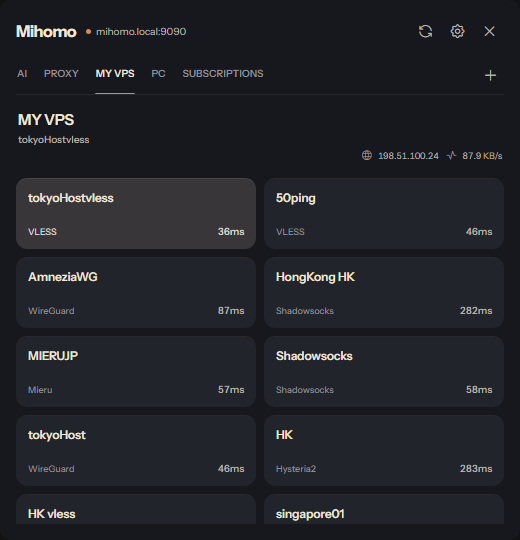
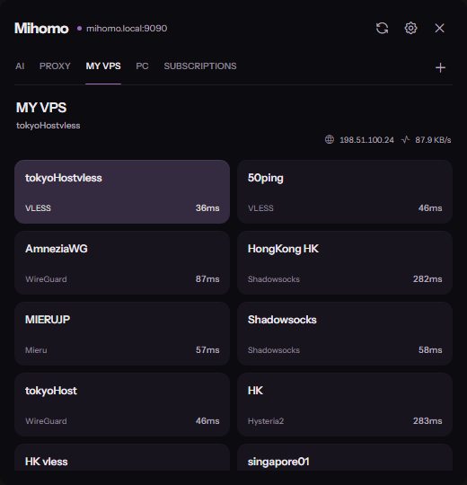

# Mihomo Widget

## Русский

Компактный виджет для Windows на Tauri. Подключается к API контроллера Mihomo по адресу и секрету, показывает группы, прокси и подписки, позволяет переключать узлы и проверять задержку без постоянного открытия браузера.

Возможности: системный трей, 16 тем и системная тема, русский и английский интерфейс, флаги и цветной пинг, прозрачность, автозагрузка, закрепление поверх окон, прилипание к краям, запоминание положения, режим клика насквозь и сочетание `Ctrl+Shift+Space` для показа или скрытия окна. Повторный запуск открывает уже работающее окно.

### Скриншоты

На скриншотах используются демонстрационные данные.

| Noir Amber | Violet Ink |
| --- | --- |
|  |  |

Также доступны [Lumiere Dark](docs/screenshots/mihomo-widget-lumiere.png), [Moss Noir](docs/screenshots/mihomo-widget-moss-noir.png), [Графит](docs/screenshots/mihomo-widget-graphite.png) и [экран настроек](docs/screenshots/mihomo-widget-settings.png).

### Установка

Скачайте `.exe` или `.msi` со страницы [Releases](https://github.com/rusanoff1983-del/Mihomo-widget/releases). При первом запуске в настройках укажите адрес контроллера и API secret. Они не включены в исходники и установщики. Закрытие окна скрывает его в трей; для полного выхода используйте пункт **Выход** в меню трея.

### Разработка и обновления

На Windows с Node.js, Rust и MSVC: `npm ci`, затем `npm run dev`. Для релизной сборки нужен приватный ключ подписи Tauri в переменной `TAURI_SIGNING_PRIVATE_KEY`; ключ хранится вне репозитория. Выполните `npm run build`. Исходники Electron-прототипа в отдельной папке этим проектом не затрагиваются.

Приложение проверяет обновления по `latest.json` в GitHub Releases. Новый релиз должен содержать подписанный пакет обновления и `latest.json`. Рабочий процесс `.github/workflows/release.yml` готовит черновик релиза, если в настройках репозитория задан секрет `TAURI_SIGNING_PRIVATE_KEY`. Увеличивайте версию в `package.json`, `src-tauri/Cargo.toml` и `src-tauri/tauri.conf.json` перед следующей публикацией.

## English

A compact Windows widget built with Tauri. It connects to the Mihomo controller API using an address and secret, displays proxy groups, nodes and subscriptions, and lets you switch nodes and check latency without keeping the dashboard open in a browser.

Features: system tray, 16 themes plus a system theme, Russian and English UI, optional flags and colored latency, opacity, autostart, always on top, edge snapping, saved window position, click-through, and `Ctrl+Shift+Space` to show or hide the widget. Launching it again focuses the existing instance.

### Screenshots

Screenshots use demo data. See the theme previews above and the linked settings screen.

### Install

Download the `.exe` or `.msi` from [Releases](https://github.com/rusanoff1983-del/Mihomo-widget/releases). On first launch, enter your controller address and API secret in Settings. Neither is embedded in the source or installers. Closing the window hides it in the tray; use **Quit** in the tray menu to exit fully.

### Development and updates

On Windows with Node.js, Rust and MSVC, run `npm ci` followed by `npm run dev`. Release builds require the Tauri private signing key in `TAURI_SIGNING_PRIVATE_KEY`; keep that key outside the repository. Run `npm run build`. The separate Electron prototype is untouched.

The app checks GitHub Releases for `latest.json`. Future releases must contain a signed update package and `latest.json`. `.github/workflows/release.yml` prepares a draft release after the repository secret `TAURI_SIGNING_PRIVATE_KEY` is configured. Bump the version in `package.json`, `src-tauri/Cargo.toml` and `src-tauri/tauri.conf.json` before each new release.
